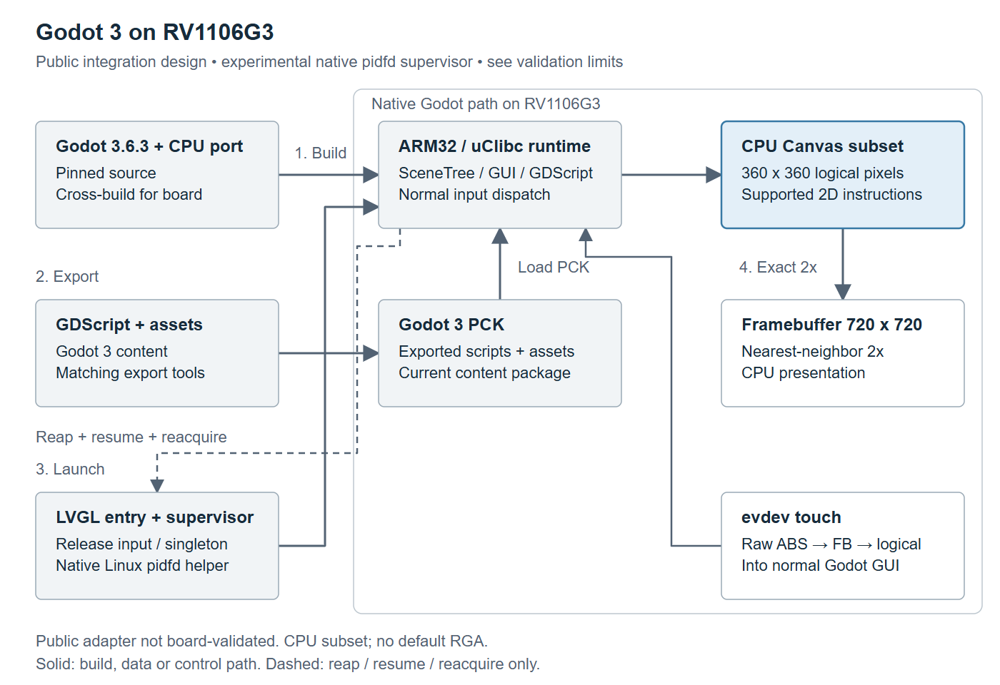
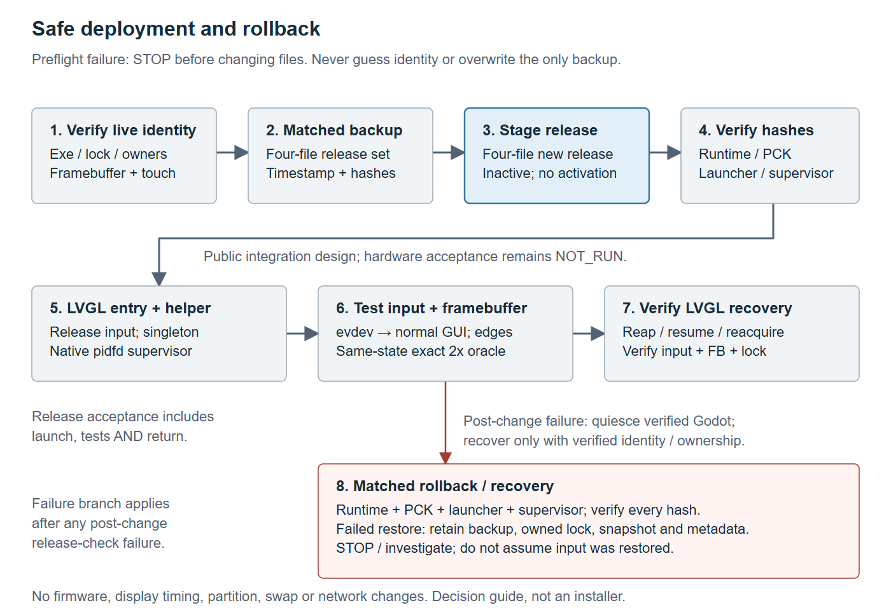
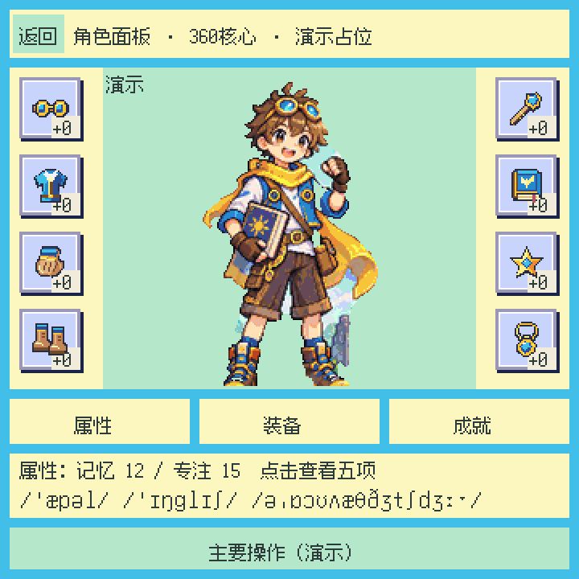

# RV1106G3 的独立 Godot3 CPU Canvas 移植

这是 **Godot3.6.3 + GDScript + ARM32/uClibc** 的受限 CPU Canvas 后端，
不是 GPU 驱动，也不是完整 Godot 兼容层。Godot4/C# 不属于本项目。

包含完整必要后端源码/头文件、固定版本安装器、构建脚本、共享显示/触摸映射测试，
以及原创中性360×360演示（8槽/3页签/详情/动作/返回）。无原应用人物、美术、字体文件。

快速开始见 [英文README](README.md)：Linux主机准备Python3、SCons4.8.1、
Luckfox GCC8.3 ARM32硬浮点uClibc工具链；克隆固定Godot提交，配置GODOT_SRC和
TOOLCHAIN_PREFIX，再运行 sh scripts/build_godot3.sh。必须用匹配sysroot，不能换glibc。
用Godot3.6.3编辑器导入demo并导出PCK；生产工程不得包含720的test_width/test_height，
否则可能出现输入二次缩放。后端负责360→720最近邻2倍显示及反向触摸映射。

[板端安全接入/成套回退](docs/DEVICE.md)：先核实fb0/event0、尺寸格式、LVGL PID/exe，
备份并校验当前公开runtime/PCK/launcher/supervisor四文件成套版本；单实例暂停桌面、备份屏幕、运行、退出后恢复。
新接入需另编译desktop-supervisor，Linux须支持pidfd；LVGL必须在fork前释放/关闭
evdev grab，子进程退出后由异步waitpid轮询重新打开/抓取，SIGSTOP本身不会释放输入。
本公开supervisor及中性demo属实验源码，尚需真实板端验证；恢复失败返回非零并保留恢复锁/快照。
新脚本只上传到新目录，不自动覆盖或激活，不改固件/DT/网络/开机服务。默认CPU O3/full，禁RGA。

[最终P6性能参考表](docs/EVIDENCE.md#final-p6-performance-reference-not-a-fair-speed-comparison)：
列出旧270与最终360生产包三轮平均渲染/提交耗时。布局、素材、字体和更新API不同，
**不是严格同工作负载对比**，不宣称加速比例，也不是本仓库中性demo的实测。

[证据说明](docs/EVIDENCE.md)：历史360包8.246ms是三轮平均渲染耗时的中位数，
不是FPS/p95；88次为evdev程序注入，非真人手指。截图不证明LCD光学或触摸到光子延迟。
新中性demo/参数化launcher尚需真机复验，不能挪用历史PASS。

原创代码MIT；保留Godot MIT及上游第三方声明，见 [许可来源](docs/PROVENANCE.md)。

## 架构与部署示意

[完整图注、可编辑SVG与原创许可](docs/FIGURES.md)。图示为**新公开实验接入设计**；
公开pidfd supervisor、输入释放/重新抓取hooks及新失败退出行为尚未板端验收，
历史P6原入口成功不等于本接入已通过真机验证。

## 实际界面截图

2026-10-15 RV1106 实际 framebuffer 读回（不是 LCD 实拍），展示独立角色原型，
不是本仓库中性 demo，也不证明新 supervisor 已板端验收。

[全部截图、Godot3 六种分辨率效果与局限](docs/SCREENSHOTS.md)。
仅供文档展示，[代码 MIT 不授予画面素材复用许可](LICENSES/SCREENSHOTS.md)。
