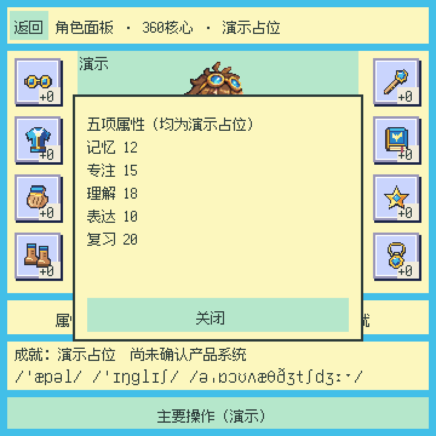
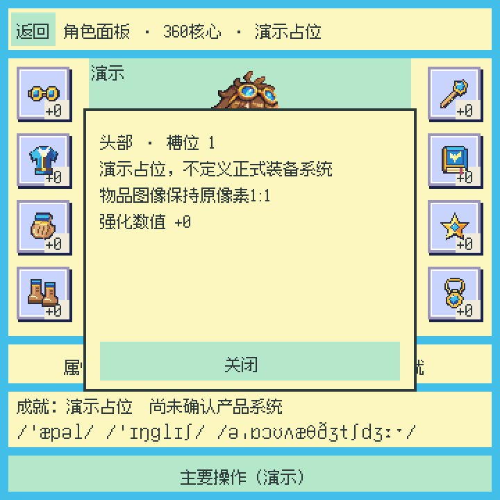
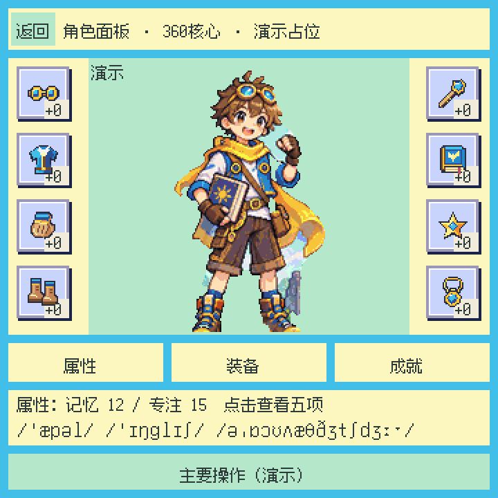
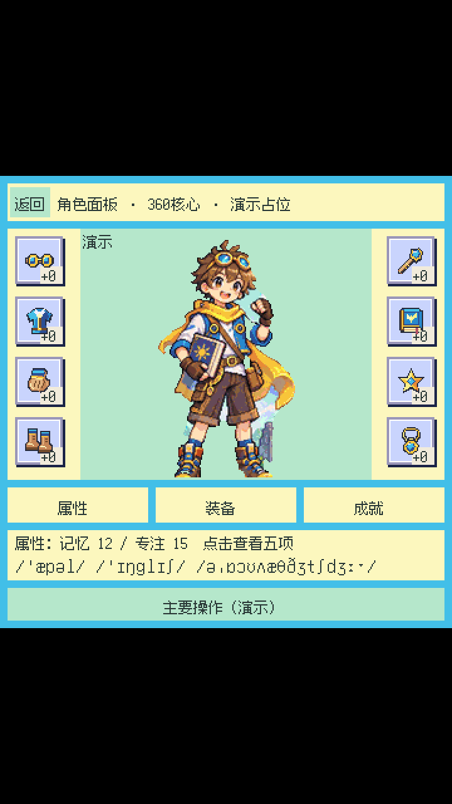

# Actual UI screenshots / 实际界面与分辨率效果

These images depict a **separate maintained Godot3/GDScript character-panel
prototype**, not the original neutral demo packaged in this public repository.
Screenshots are documentation only: [MIT does not relicense depicted artwork or
third-party material](../LICENSES/SCREENSHOTS.md); no grant of artwork reuse.

## Historical actual RV1106 framebuffer — 2026-10-15

Actual RV1106G3 BGRx32 framebuffer readback, 720×720, stride 2880; logical UI
360×360, content rectangle (0,0,720,720), exact nearest 2×. These are historical
captures, **not a new device run**, not LCD photos, and not evidence that the new
public neutral demo, pidfd supervisor or input hooks passed board acceptance.
No board/ADB/SSH operations were performed for this gallery.

### Core page

### Five-attribute overlay

### Equipment popup

The historical same-state desktop/FB audit reported zero different pixels for
core and attributes at 2×; the popup has no equivalent zero-difference claim.
These separate states must not be compared as identical images. Framebuffer
readback does not prove LCD optics, physical touch, display FPS or latency.
See [historical evidence boundaries](EVIDENCE.md).

## New Godot3 desktop render targets — 2026-10-16

Actual Godot **3.6.3-stable official Mono**, GDScript only, GLES2 rendering.
The same unmodified maintained Panel.gd/Panel.tscn and imported resources were
copied into a private disposable capture fixture, not another maintained app.
No Godot4 project was run, modified or used to generate these images.

**Classification: Godot3 desktop offscreen rendered target; not Android, not
RV device output, not an OS-window screenshot.** Actual engine Viewport and
TextureRect rendering produced every full-size PNG. Python only removed PNG
metadata and audited pixels; it did not manufacture the displayed resolutions.
The capture uses render_target_v_flip=true for source and target Viewports;
Image readback is already upright in this tested path, so no additional
Image.flip_y is applied. All seven desktop PNGs were freshly engine-captured
with that policy. Orientation was independently checked against the upright
historical RV header (zero pixel differences in the invariant header region)
and production geometry: header at logical y6, main action near y328.
This independent check complements, rather than replaces, same-source scaling
audits. The seven new capture hashes supersede earlier rejected capture hashes.

Production settings are 360×360, stretch mode viewport, aspect keep, black clear
color. Native engine runs confirmed a 360×360 logical/root texture at all six
requested dimensions. This Windows work area clamped tall hidden native windows
to height 1203 (720×1280, 1080×1920, 1080×2400, 1440×3200 requests), so native
window results are **not** presented as full-size screenshots. Separate desktop
render targets explicitly reproduce centered aspect-keep/nearest presentation
at the requested dimensions. This is a fixture presentation policy consistent
with those settings, **not a newly deployed native automatic strategy**.

All six targets use the identical default core page state, 360×360 logical
source. Black letterbox regions are preserved. No responsive reflow, extended
mobile UI, Android safe-area/keyboard support or mobile-device validation is
claimed. Only these square/integer-width targets have uniform integer pixels;
768×1024 deliberately shows the fractional limitation, not an integer PASS.

| Target PNG (actual engine pixels) | Logical | Content rectangle x,y,w,h | Scale | Pixel audit vs same-state nearest oracle |
|---|---|---|---|---|
| [720×720](images/screenshots/desktop-core-720x720.png) |360×360|0,0,720,720|2×|0 differences; uniform 2×|
| [720×1280](images/screenshots/desktop-core-720x1280.png) |360×360|0,280,720,720|2×|0 differences; uniform 2×|
| [1080×1920](images/screenshots/desktop-core-1080x1920.png) |360×360|0,420,1080,1080|3×|0 differences; uniform 3×|
| [1080×2400](images/screenshots/desktop-core-1080x2400.png) |360×360|0,660,1080,1080|3×|0 differences; uniform 3×|
| [1440×3200](images/screenshots/desktop-core-1440x3200.png) |360×360|0,880,1440,1440|4×|0 differences; uniform 4×|
| [768×1024](images/screenshots/desktop-core-768x1024.png) |360×360|0,128,768,768|32/15 ≈2.1333×|0 differences; unequal 2/3-pixel cells, **not integer scale**|

[Actual same-run 360×360 source viewport](images/screenshots/desktop-core-360.png).
Each content area was compared pixel-for-pixel against this source expanded by
independent nearest sampling; all black bars were independently checked black.
Zero interpolation differences is not proof of equal-sized cells at fractional
scale. Browser/GitHub downscaling can blur previews; open original PNG at 100%.
The new default state differs from some historical selected-tab/badge states;
no new desktop-vs-historical-RV zero-difference claim is made.

### Square desktop target

### Long desktop target — actual unused space retained

## Integrity and publication boundary

All ten published PNGs retain the visible RGBA pixel hashes of their respective
current raw captures after metadata-only chunk removal. The seven desktop
captures have newly recorded hashes; these are not the rejected attempt's hashes.
Only IHDR, IDAT and IEND remain. Publication tests use an exact
per-path allowlist and dimensions, signature/CRC/chunk validation, bounded zlib
decode, scanline checks, relative links and unchanged all-Git-blob privacy gates.
PNG SHA-256 values are in [SOURCE_MANIFEST.sha256](../SOURCE_MANIFEST.sha256).
No raw framebuffer dump, private logs, capture helper, model/data, app source,
font/art source, engine executable, SDK or PCK is distributed.

## 中文摘要

- 三张 RV1106 图是 **2026-10-15 实际 framebuffer 读回**，不是 LCD 实拍；
  是独立角色原型，不是本仓库中性 demo 或新 supervisor 的板端验收。
- 六种尺寸为 **2026-10-16 Godot3.6.3/GDScript 真实桌面离屏渲染目标**，
  不是手机、Android 或 RV 实机。本机高窗口被限高，未冒充目标尺寸 OS 截图。
- 当前仍是 360 方形核心等比居中加黑边；长屏留白如实保留，不宣称动态高度、
  移动端适配或安全区已经实现。768 宽为约 2.1333 倍最近邻，像素格不均匀。
- 截图仅作界面文档展示；代码 MIT 不授予角色、美术或第三方素材复用许可。
